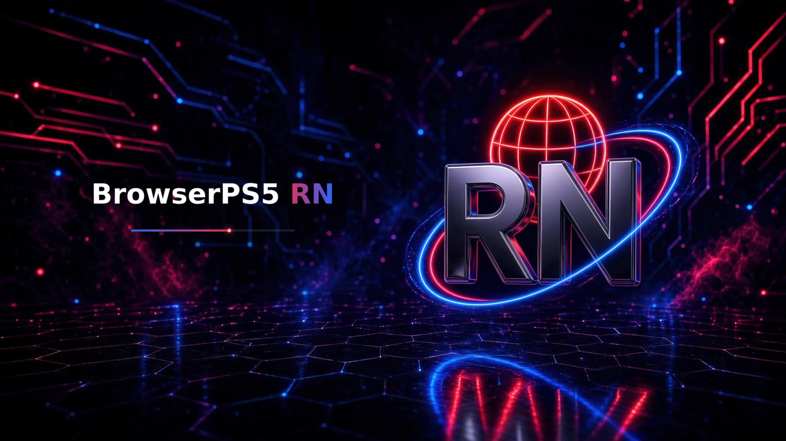
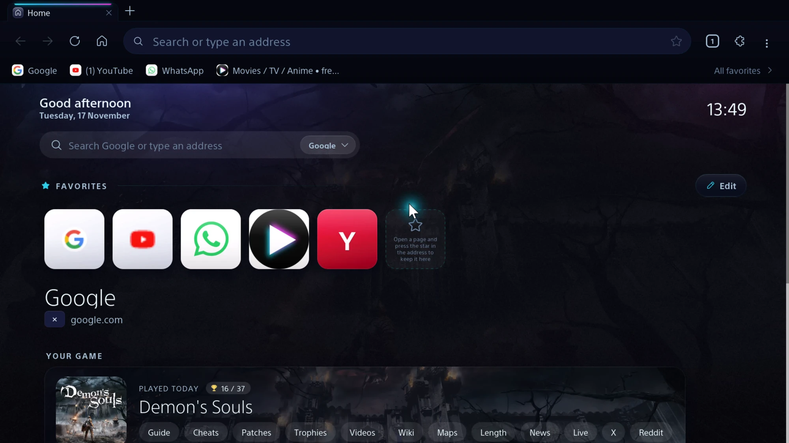
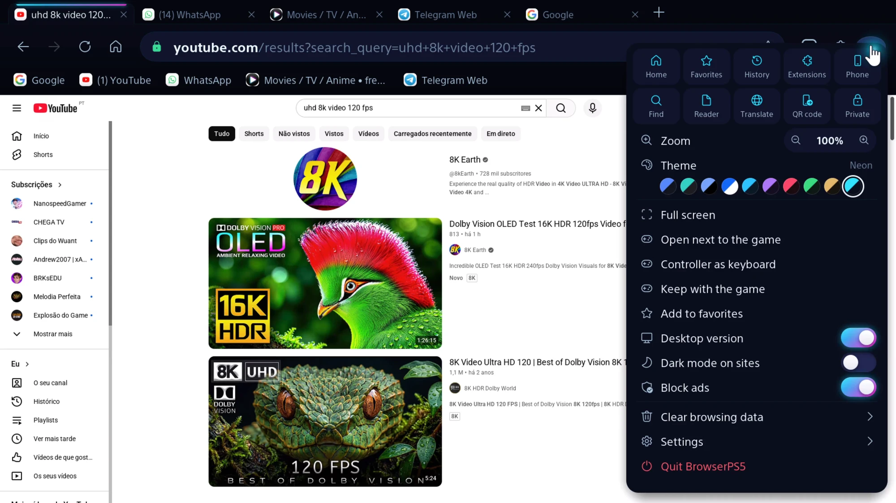
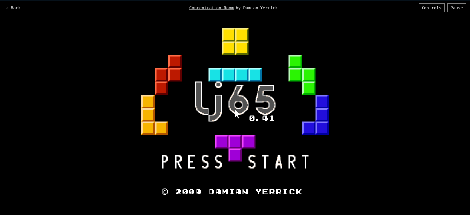
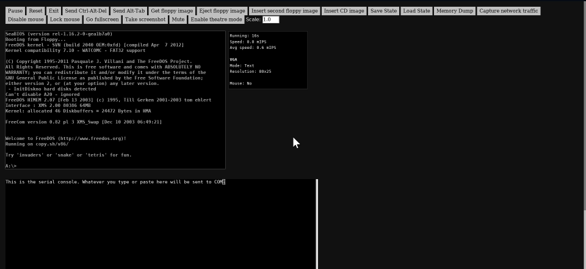
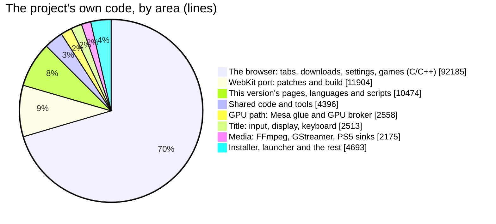
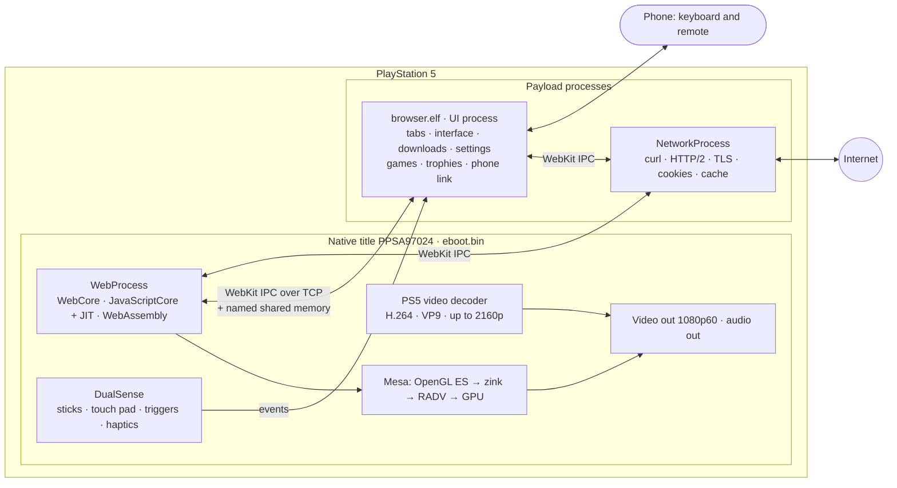
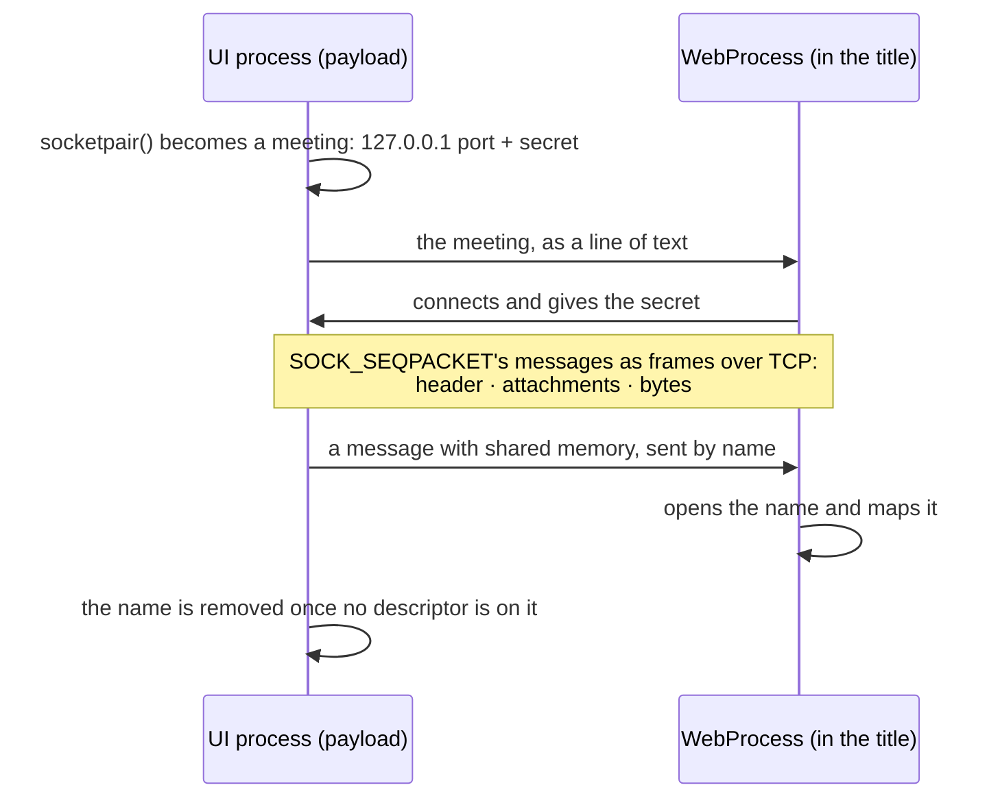
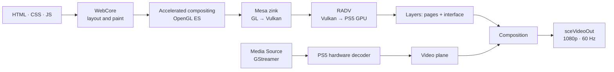
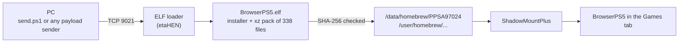

<p align="center">
  
</p>

<h1 align="center">BrowserPS5</h1>

<p align="center">
  <b>A real, full web browser for the PlayStation 5.</b><br>
  Its own port of a current WebKit, with the JavaScript JIT, drawn on the console's GPU and driven with the DualSense.
</p>

<p align="center">
  <a href="https://github.com/ramalhoboss/BrowserPS5/releases"></a>
  
  
  
  <a href="LICENSE"></a>
</p>

---

BrowserPS5 is a **native PS5 title** (`PPSA97024`) that appears in the **Games** tab of the home screen. It is not the console's hidden system browser: the engine, the interface and every feature described here come with it.

> [!WARNING]
> **Read first.** BrowserPS5 is an unofficial homebrew project. It is **not affiliated with, endorsed by or connected to Sony Interactive Entertainment, Apple, the WebKit project or any site it opens**. It needs a jailbroken PS5. **Use it at your own risk**: you alone are responsible for your console and for the accounts you sign in to. It was tested on firmware 13.60 only.

## Contents

- [Screenshots](#screenshots)
- [What is inside](#what-is-inside)
- [The project in numbers](#the-project-in-numbers)
- [How it works](#how-it-works)
- [What it took to get here](#what-it-took-to-get-here)
- [Compatibility](#compatibility)
- [Installation](#installation)
- [Updating and uninstalling](#updating-and-uninstalling)
- [Controls](#controls)
- [Downloads](#downloads)
- [Files on the console](#files-on-the-console)
- [Privacy and security](#privacy-and-security)
- [What it does not do](#what-it-does-not-do)
- [Troubleshooting](#troubleshooting)
- [Building from source](#building-from-source)
- [Licences and thanks](#licences-and-thanks)

---

## Screenshots

| The start page, with the game you played last | The menu over a YouTube search |
| :---: | :---: |
|  |  |

| An NES emulator in JavaScript (JSNES, free homebrew) | An x86 PC in WebAssembly booting FreeDOS (v86) |
| :---: | :---: |
|  |  |

All four are captures taken on the console.

---

## What is inside

### A browser, the way you know one

- **Tabs** that stay loaded (up to 6), **private tabs** that write nothing, a button to reopen the tab you just closed, and **the tabs of last time** when you open it again.
- **Start page** in the style of the PS5's home screen, with your favorites as tiles, and a **favorites bar** under the address.
- **Address bar** with search (Google, DuckDuckGo, Bing, Ecosia, Startpage or Brave Search) and suggestions from your favorites and history.
- **Find in page**, **reading mode**, **translate the page**, zoom, desktop or mobile version of a site, dark mode for sites, full screen, and a **QR code** of the page's address to carry on with it on a phone.
- A menu on any link or picture (hold ✕): open in a new tab, in a private tab, save the picture.
- **History**, **saved logins** that fill themselves in, and "Clear browsing data".
- **Ad blocker** built on WebKit's own content rules, with a list of sites where ads stay on, and **extensions** as user scripts (a Greasy Fork manager is included).
- **PDF reader** (PDF.js): a PDF a page links to opens in the browser.
- **Clear error pages** when a site does not load: what happened, in your language, with a button to try again. There is no way past a certificate that fails.
- **7 languages**: English, Português, Español, Français, Deutsch, Italiano and Nederlands, for the pages, the menus and the browser's own messages. A new install starts in your console's language.

### Video, sound and graphics

- **YouTube up to 2160p**, with H.264 and VP9 decoded by the PS5's own video hardware.
- **YouTube's TV interface** (`youtube.com/tv`) from a tile on the start page, driven with the D-pad like the console's own app.
- **WebGL 1 and 2**, **WebAssembly**, **Web Audio**, Media Source Extensions and the Media Session API.
- **Emulators and games that run in a page**: JSNES ran homebrew at a steady 60 frames a second and v86 booted FreeDOS in under 18 seconds on the console, with the DualSense as their keyboard.

### Messaging sites

- **WhatsApp Web** and **Telegram Web** work: QR code linking, chats, files.
- **Site notifications become PS5 notifications.** The first time a site wants to send them, the browser asks: Allow or Block.
- **Send files to a page** from the console: your PS5 screenshots and video clips, your downloads, a USB drive.

### Downloads that finish

- **Several connections at once** for large files (200 MB or more, up to 8): about three times as fast as one connection on the same line.
- **A failing network does not lose a download.** Connections that drop or go silent are replaced, and the download goes on from the bytes it already has.
- **Pause and continue**, and **continue after closing the browser**: an unfinished download is listed as *Interrupted* the next time, with a button to go on from where it stopped.
- Choose the folder for each file, or let each type go to its own folder; USB drives are offered; `.zip` files can be extracted; videos, music and PDFs open in the browser.

### Made for the PS5

- **DualSense all the way**: a cursor with a magnet for links, the D-pad jumping between links and buttons, radial menus on L2 and R2 with a click in the adaptive triggers, haptics, the light bar in the theme's colour.
- **The touch pad as a laptop's**: a finger moves the cursor, a tap clicks, two fingers scroll the page and it glides on after they leave.
- **The PS5's own keyboard** for text (firmware 13.60), with its suggestions and layout; passwords, and other firmwares, get the browser's own keyboard.
- **16 themes**, six of them seasonal and switched by the calendar, and an animated starting screen.
- **Open beside the game**: sends the page you are on to the PS5's own side card, next to your game.
- **Your phone as keyboard and remote**: pair it with a code or a QR code, type on it, send links and files to the console, and see the console's downloads.

### For players and homebrew

- **"Your game" on the start page**: the game open or played last, with its cover, its background and your trophies of it, and one press to its guide, videos, wiki, maps, news, who is live with it, X and Reddit.
- **A page for each game**: its trophies one by one (the ones still to win first, each with a search for how to win it), **Play** (the browser closes and the game starts by itself), your **notes**, **your captures** of it, and the **pages you kept with it**.
- **Your games**: every game of the console as a grid of covers, by recent, by name or by trophies (the closest to the platinum first).
- **Homebrew**: the scene's tools (etaHEN, websrv, elfldr, ftpsrv, shsrv, klogsrv, the payload SDK) with their newest release read from GitHub, and which of them run on the console now.
- **Cheats and patches for etaHEN**: the cheat files of [etaHEN/PS5_Cheats](https://github.com/etaHEN/PS5_Cheats) and the patches of [illusionyy/PS-Game-Patch](https://github.com/illusionyy/PS-Game-Patch) for that very game, saved where etaHEN reads them. The browser only puts the files in place; applying patches needs etaHEN's patches plugin.
- **Captures to Discord**: a screenshot or clip of a game, from its page, to a channel of yours through its webhook.
- **The console's health**: temperatures, power use, clock, the fan's target, uptime, disks, and a network test. Only read: nothing is changed.
- **The controller as a keyboard, per site**: arrows or W A S D, space, Enter and more, for web games that want a keyboard.
- **Run a payload you downloaded**: a finished `.elf` in Downloads can be sent to the console's ELF loader, after you confirm.

---

## The project in numbers

| | |
| --- | --- |
| **Engine** | WebKit 627.1.7 (trunk of November 2026): WebCore, JavaScriptCore with its JIT tiers, WebAssembly |
| **Changes to WebKit** | 49 patch and replacement files plus 77 in-place source edits, each with the reason it exists (`poc/webkit/`) |
| **The project's own code** | About 130,000 lines of C, C++, JavaScript, CSS and shell, not counting WebKit or any library |
| **The browser's main program** | `poc/browser/main.cpp`, 21,000 lines |
| **Libraries built for the PS5** | More than 35: Mesa, GStreamer, FFmpeg, cairo, HarfBuzz, ICU, curl, nghttp2, OpenSSL, SQLite, ANGLE and the rest ([notices](THIRD-PARTY-NOTICES.md)) |
| **One-file installer** | `BrowserPS5.elf`, 110 MiB: 338 files packed with xz, checked by SHA-256, unpacked on the console in 30 seconds |
| **Tests** | 287 unit checks on the PC, and 15 scenarios run on the console itself before every release |
| **Interface** | 7 languages, 16 themes, 1080p at 60 frames a second |



Measured on the console (firmware 13.60):

| What | Result |
| --- | --- |
| Install with the one-file installer | 323 files, 421 MiB, **30 s** |
| From launch to the start page loaded | about **9 s** |
| 24 of the most used sites, one after another | **24 of 24** loaded, 155 s in all |
| JSNES (NES emulator in JavaScript) | **59.9 frames a second** |
| v86 (x86 PC in WebAssembly) to the FreeDOS prompt | **17.5 s** |
| A large download over several connections | about **3×** one connection |

---

## How it works

### Three processes, two worlds

A PS5 title has the screen, the GPU and a large share of memory, but it cannot start other processes or receive file descriptors. A payload can do both, but has no screen. WebKit wants several processes that pass descriptors to each other. BrowserPS5 splits the engine across the two worlds and carries WebKit's messages between them itself.



The interface is itself made of web pages: the bar, the menus, the start page, the settings and the on-screen keyboard are HTML, CSS and JavaScript drawn by the same engine, each in its own layer.

### WebKit's IPC, without descriptors

WebKit's processes talk over `socketpair()` and send each other descriptors with `SCM_RIGHTS`. Neither crosses the line between a payload and a title. `poc/webkit/ipc-transport/` replaces both underneath WebKit, with the rest of the engine unchanged:



A title also refuses `dup()`, `dup2()` and `fcntl(O_NONBLOCK)` on a socket; each has its answer in the transport and in the title's wrappers.

### A frame, from the page to the TV



### One file to install



---

## What it took to get here

The PS5's own WebKit is old, locked down and out of reach for homebrew, and a first prototype on it was dropped for being too limited. The project then took the hard road: port upstream WebKit's PlayStation port, which is written against Sony's private SDK, to the open [ps5-payload-sdk](https://github.com/ps5-payload-dev/sdk), and build everything it stands on.

| When (2026) | Milestone |
| --- | --- |
| 2 November | The project begins. Decision: upstream WebKit, with the open SDK in the place of Sony's private pieces |
| 3 November | WebKit links for the PS5 (library, WebProcess, NetworkProcess). First page on the TV, then HTTPS, the controller, the system keyboard and a first address bar, all the same day |
| 5 November | The pages' process moves inside the title; WebKit's IPC runs over TCP and named shared memory |
| 6 – 7 November | "Open beside the game" through the system's side card. Pages reach the GPU: Mesa's zink over RADV, pixels on the PS5's video out |
| 8 – 9 November | H.264 and VP9 decoded by the console's video hardware, up to 2160p. The starting screen |
| 10 – 11 November | The PS5-style interface (BrowserPS5 RN). The full engine: WebGL, Web Audio, notifications, Media Session, MathML |
| 12 – 13 November | PDF reader, downloads over several connections that go on after a cut |
| 14 – 15 November | Release candidates 1 to 8: installer and uninstallers in one file each, ad blocker, the PS5's own keyboard, 24-site test on the console |
| 16 November | rc9 to rc11: your games and trophies, a page for each game, cheats and patches, captures, Discord, the console's health, emoji |
| 17 November | rc12: the touch pad as a laptop's, key codes for web games and emulators, the animated starting screen, a race in the IPC found and fixed |

Some of the problems that had to be solved on the way, each documented where it is solved:

- **Sony's private headers and libraries.** The PlayStation port expects a process launcher, a certificate store, a library loader and memory APIs that only Sony's SDK has. Each got an open replacement (`poc/webkit/process-launcher/`, `certificate-store/`, `library-bundle/`, `malloc/`, `locks/`).
- **A title cannot be handed a descriptor.** The whole IPC layer was rebuilt underneath WebKit (above). One of its bugs showed in 1 run in 40: a name of shared memory removed a moment too early, and a page stood still. It is fixed and has its own test.
- **No GPU API for homebrew.** Pages are composited through Mesa: zink turns OpenGL ES into Vulkan and RADV, in [Mihawk's PS5 port](https://github.com/mihawk-99/PS5_Vulkan), drives the console's GPU.
- **The JavaScript JIT** runs in a pool of executable memory inside the title, with JavaScriptCore's tiers and WebAssembly.
- **Video without software decoding.** GStreamer and FFmpeg were built for the SDK, with two sinks written for the PS5: sound to the console's audio out, and video through the console's own decoder.
- **Typing.** The PS5's keyboard is loaded and bound at run time, with the browser's own keyboard for passwords and for firmwares where that cannot be done.
- **A network stack to trust.** curl with HTTP/2, certificates always verified against Mozilla's list, and pages refused when they try to reach the console's own unprotected services.
- **Memory.** A title gets 1 GiB of flexible memory for the pages; tabs share it, and the engine's allocator and locks were adapted to the console.
- **Shipping.** One ELF that carries 338 files, checks them, refuses to write while the browser is open, and never touches the user's data; and uninstallers that leave the downloads alone.
- **Testing on the real thing.** Every release runs 15 scenarios on the console (sites, video, PDF, downloads that are cut and resumed, private tabs, uploads, translation), with the screen captured into the log.

---

## Compatibility

### Console

| | |
| --- | --- |
| **Tested** | One PS5, system software **13.60**, with etaHEN and ShadowMountPlus |
| **Needs** | A jailbroken PS5 with an **ELF loader on port 9021** (etaHEN starts one) and **ShadowMountPlus** running |
| **Other firmwares** | Not tested. Almost everything finds the system's functions by name. The PS5's own keyboard is bound for 13.60; elsewhere the browser's own keyboard is used |
| **Storage** | About 450 MB on the console |
| **Display** | 1080p interface at 60 Hz; video up to 2160p |

Reports from other firmwares are welcome: open an issue with the firmware, what worked and the logs (see [Troubleshooting](#troubleshooting)).

### The web

| Works | Does not work |
| --- | --- |
| YouTube up to 2160p (H.264, VP9), and `youtube.com/tv` | Video with DRM: Netflix, Disney+, Prime Video, Spotify's web player |
| WhatsApp Web and Telegram Web: linking, chats, files | Calls, camera and microphone (no WebRTC), so no cloud gaming |
| WebGL 1 and 2, WebAssembly, Web Audio, Media Source Extensions | Text-to-speech |
| Emulators and games that run in a page, with the controller as their keyboard | More than 6 tabs |
| PDF files, downloads, uploads, site notifications | |

Every release is also tried against 24 of the most used sites, one after another, on the console: Google, Wikipedia, YouTube, GitHub, Reddit, Amazon, eBay, BBC News, X, Twitch, Instagram, Facebook, Netflix and Spotify (their pages; not their DRM players), Google Maps, WhatsApp, Telegram, Gmail, IMDb, Stack Overflow, Speedtest, PlayStation.com and others. In this release all 24 load.

---

## Installation

1. **Download** `BrowserPS5-<version>.zip` from [Releases](https://github.com/ramalhoboss/BrowserPS5/releases) and unzip it.
2. **Check the files** (optional, recommended). In PowerShell, in the unzipped folder:

   ```powershell
   Get-FileHash .\BrowserPS5.elf -Algorithm SHA256
   ```

   The result must match the line for `BrowserPS5.elf` in `SHA256SUMS.txt`.
3. **Load your jailbreak** on the PS5 and make sure ShadowMountPlus is running.
4. **Send `BrowserPS5.elf` to port 9021** with the payload sender you already use. On Windows, the included `send.ps1` does it:

   ```powershell
   .\send.ps1 -Ps5 <your PS5's IP> -Elf .\BrowserPS5.elf
   ```

   The PS5's IP is in *Settings → Network → Connection Status → View Connection Status*. If PowerShell refuses to run the script:

   ```powershell
   powershell -ExecutionPolicy Bypass -File .\send.ps1 -Ps5 <IP> -Elf .\BrowserPS5.elf
   ```

   On Linux or macOS:

   ```bash
   nc -w 3 <your PS5's IP> 9021 < BrowserPS5.elf
   ```
5. **Wait for the two notifications** on the PS5: *"installing, about half a minute"* and then *"is installed"*. Do not open the browser in between.
6. **Open BrowserPS5** from **Games** on the home screen. ShadowMountPlus adds it about 15 seconds after the install. The icon and background may only show after the PS5 restarts.

The installer writes about 450 MB and takes half a minute. It writes only inside `/data/homebrew` and `/user/homebrew`, closes no app, and changes no system setting.

---

## Updating and uninstalling

**Updating**: send the newer `BrowserPS5.elf` the same way as the first time, **with the browser closed**. Your favorites, history, settings, logins and unfinished downloads stay. If the browser is open, the installer writes nothing and says so in a notification.

**Uninstalling**: send `BrowserPS5-uninstall.elf` the same way:

```powershell
.\send.ps1 -Ps5 <your PS5's IP> -Elf .\BrowserPS5-uninstall.elf
```

It asks ShadowMountPlus to take the tile off the home screen and deletes what the installer wrote. **Your favorites, history, settings and logins stay**, for the next install. `BrowserPS5-uninstall-all.elf` removes them too. The files you downloaded are never touched. If the tile is still on the home screen afterwards, delete it there (Options → Delete).

---

## Controls

| Control | What it does |
| --- | --- |
| **Left stick** | Move the cursor |
| **Right stick** | Scroll the page |
| **✕** | Click · hold on a link or picture for its menu |
| **D-pad** | Jump to the next link or button (or scroll, or send arrow keys: *Settings → Controller*) |
| **○** | Back · close a menu |
| **L1 / R1** | Back / forward |
| **△** | Type an address |
| **□** | Enter |
| **L2 / R2** | Radial menus: *Go to* and *Page* |
| **Touch pad, a finger** | Move the cursor, as on a laptop: slowly for small steps, fast to go far · **tap** to click |
| **Touch pad, two fingers** | Scroll the page with them; it glides on a little after they leave, and a finger on the pad stops it |
| **Touch pad, pressed** | Tabs · on a site with games, hands the controller to the game |
| **Options** | Menu: favorites, history, find, reading mode, translate, private tab, zoom, full screen, settings, quit |

Every one of these is listed in *Settings → Controller*, with the cursor's speed, haptics, sounds and the light bar.

---

## Downloads

- Files go to `/data/downloads`, videos, music and pictures to `/data/media`, and `.pkg` files to `/data/pkg`. Each folder can be changed in *Settings → Downloads*, and the browser can ask where to save every file. **Nothing is installed by the browser**: a `.pkg` is only saved.
- *Fast downloads* (on by default) brings large files over several connections. If the server does not allow it, or it is not faster, the browser goes back to one connection by itself.
- While a download waits for the network it says so in the list, and goes on by itself when the network returns.
- **Pause**, **Continue**, **Try again** and **Delete** are on each line of *Settings → Downloads*. Delete only removes files inside the download folders.
- An unfinished download is kept for 14 days.

---

## Files on the console

| Path | What is there |
| --- | --- |
| `/data/homebrew/PPSA97024/` | The title: `eboot.bin`, the browser itself (`browser.elf`), fonts, `sce_sys/` (icon, backgrounds, `param.json`), and its own logs |
| `/user/homebrew/lib/libWebKitFull.so.SOVERSION` | The engine's library |
| `/user/homebrew/browserps5-rn/full/`, `pdfjs/` | The engine's processes and the PDF reader |
| `/user/homebrew/browserps5-rn/data/` | **Yours**: favorites, history, settings, saved logins, cookies and site data, extensions, unfinished downloads' maps |
| `/user/homebrew/lib/libEGL.so.1`, `libvulkan.so.1` | Mesa, shared with other homebrew: written only if the console has none |
| `/user/homebrew/etc/`, `/user/homebrew/share/fonts/` | Certificates (Mozilla's CA list) and fonts, shared the same way |
| `/data/downloads`, `/data/media`, `/data/pkg` | What you download (the folders can be changed) |

---

## Privacy and security

- Everything you do stays **on your console**. BrowserPS5 has no telemetry, no account and no server of its own; it talks to the sites you open and to the search engine you chose.
- HTTPS certificates are **always verified**. There is no "accept any certificate" mode.
- **Pages cannot reach the console's own services.** A jailbroken PS5 listens on its local network (FTP, the ELF loader, other tools) with no password; a web page that tried to connect to them is refused. Only an address you type yourself may open them.
- Private tabs keep their cookies and site data in memory only, and leave no history, no saved session and no saved login.
- Saved logins are kept on the console, in the browser's data folder. Anyone with access to the console's files (FTP on a jailbroken console) can read that folder: treat the console as you would an unlocked PC.
- The browser changes no PS5 system setting and installs nothing.

---

## What it does not do

- **No DRM video**: Netflix, Disney+, Prime Video, Spotify's web player and the like do not play.
- **No calls, camera or microphone** (no WebRTC), and no text-to-speech.
- Up to **6 tabs**, sharing 1 GiB: a very heavy page may be loaded again when you come back to it.
- *Open beside the game* shows the page in the **PS5's own side card**, a much smaller browser than this one: simple pages only.
- A download can only go on from where it stopped if the server gives parts of a file, and while its link is still valid.
- Tested on firmware **13.60** only.

---

## Troubleshooting

| What you see | What to do |
| --- | --- |
| No BrowserPS5 tile after installing | ShadowMountPlus is not running, or has not scanned yet: start it and wait about 15 s |
| The tile has no icon or background | Restart the PS5 once |
| The installer's notifications never come | Make sure the ELF loader listens on port 9021 (load your jailbreak again) and that the IP is the PS5's |
| *"is open: nothing was installed"* | Close BrowserPS5 (Options → Close application) and send the installer again |
| A site says the browser is not supported | Try *Menu → Desktop version*; some sites only accept the browsers they know by name |
| A video service will not play | It needs DRM, which BrowserPS5 does not have |
| A download stays at *waiting for the network* | The console lost its connection: it goes on by itself when the network is back |
| Downloads are slow | Use a network cable: over Wi-Fi the console takes about 27 MB/s at most |
| The cursor moves or clicks when a finger brushes the touch pad | Put an empty file named `no-touch-cursor` in `/data/homebrew/PPSA97024/` (by FTP): the pad is then only its press |

The browser's own logs are in `/data/homebrew/PPSA97024/` (`browser-run.txt`, `browser-title.txt`, `web-stderr.txt`). They are kept for the last four sessions and help when reporting a problem.

---

## Building from source

This repository is the complete source of the release of the same version: the browser, its title, its installer, the changes made to WebKit, Mesa, GStreamer and the other libraries, and the scripts that build all of it. The upstream projects are not copied here: the build scripts download each one at a fixed version.

Everything is built on Linux (or WSL) with the [ps5-payload-sdk](https://github.com/ps5-payload-dev/sdk):

| Step | Script |
| --- | --- |
| The engine (WebKit with this project's patches) | `poc/webkit/build-webkit.sh`, `poc/browser-rn/engine-rebuild-rn.sh full` |
| The title (the pages' process, video, input) | `poc/browser-rn/title-full-rn.sh` |
| The browser (interface, downloads, settings) | `poc/browser-rn/menus-full-rn.sh` |
| The release (the zip) | `poc/release-rn/build-release-rn.sh` |

The full order, what each folder is and how to run the tests are in [docs/BUILDING.md](docs/BUILDING.md). The title also needs [PS5_Vulkan](https://github.com/mihawk-99/PS5_Vulkan) built beside it: its RADV for the PS5, its GPU broker and its tools for making the PS5 executable.

| Folder | What it is |
| --- | --- |
| `poc/browser/` | The browser itself and its unit tests |
| `poc/browser/title/` | The title: the screen, the GPU, the video decoder, the keyboard, and the engine's page process living in it |
| `poc/browser-rn/` | This version's pages, languages, fonts, ad blocker, art and build scripts |
| `poc/webkit/` | WebKit for the PS5: the build, the patches and the replacement files |
| `poc/media/` | FFmpeg, GStreamer and the PS5 audio and video sinks |
| `poc/gl_zink/`, `poc/gl_soft/`, `poc/gpu_broker/` | OpenGL ES for the engine, on the console's GPU |
| `poc/release-rn/` | The installer, the uninstallers and the release's build |

The tree keeps the folder names it had while each part was first proven on the console.

---

## Licences and thanks

BrowserPS5 is free software under the **GNU General Public License, version 3 or later** ([LICENSE](LICENSE)). It comes with **no warranty**. What changed in each version is in the [CHANGELOG](CHANGELOG.md).

It is built on WebKit and on many other open projects; they keep their own licences, listed in [THIRD-PARTY-NOTICES.md](THIRD-PARTY-NOTICES.md).

Pages reach the PS5's GPU through **RADV on the PS5**, the work of Mihawk ([PS5_Vulkan](https://github.com/mihawk-99/PS5_Vulkan)) on the foundation of BlackBearReloaded's [ps5-native-app-boilerplate](https://github.com/blackbearreloaded/ps5-native-app-boilerplate). The engine's locks, and the idea of keeping pages away from the console's own services, come from rikleigh's [Parallax Browser](https://github.com/rikleigh/parallax-browser). The toolchain is the [ps5-payload-sdk](https://github.com/ps5-payload-dev/sdk). Thank you.

PlayStation, PS5 and DualSense are trademarks of Sony Interactive Entertainment. WebKit is a trademark of Apple Inc. YouTube, WhatsApp, Telegram and the other names are trademarks of their owners. BrowserPS5 is independent of all of them.
